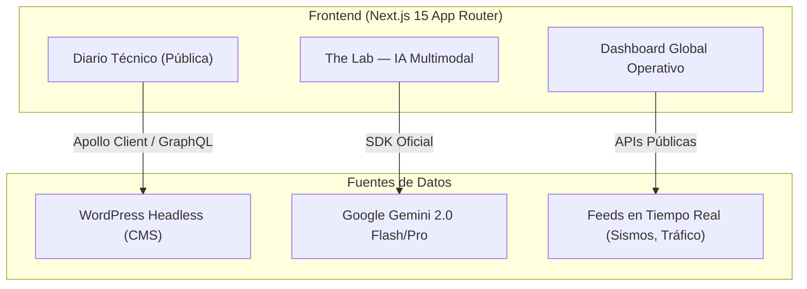

  <h1>🏛️ CRÓNICA Engineering Group</h1>
  
<em>Plataforma de Ingeniería Forense, Arquitectura y Análisis con IA Multimodal</em>

  
  
  
  

---

## 🎯 El Problema

La ingeniería forense y el análisis estructural en Venezuela enfrentan dos obstáculos críticos:

1. **Conocimiento fragmentado**: Los informes, normativas (ACI 318, ASTM, COVENIN) y análisis de fallas están dispersos en archivos estáticos o documentos físicos sin acceso rápido.
2. **Ausencia de asistencia técnica en campo**: Un profesional fuera de la oficina no tiene acceso inmediato a un experto que le ayude a interpretar una patología estructural visible en un video o fotografía.

**CRÓNICA** fue construida para resolver ambos problemas con tecnología de frontera.

---

## 🏗️ Arquitectura General

---

## ✨ Módulos Clave

### 🧪 The Lab — Laboratorio de IA Multimodal
El componente central de la plataforma. Un asistente de IA configurado con un system prompt especializado en ingeniería forense, arquitectura y normativas de construcción venezolanas e internacionales. Capacidades:
- **Análisis de Video Frame-a-Frame**: Sube un video de una edificación con daños aparentes y la IA analiza cada fotograma buscando patrones de falla (grietas, desplazamientos, eflorescencias).
- **Consulta de Normativas**: Interpreta en lenguaje natural artículos del ACI, ASTM, COVENIN e ISO.
- **Diagnóstico Estructural Preliminar**: Describe una patología y recibe un informe de causas probables y recomendaciones.

### 📰 Diario Técnico (Headless CMS)
- Alimentado por **WordPress con WPGraphQL**.
- Contenido editorial de ingeniería, análisis de casos y novedades del sector.
- Consultas optimizadas vía **Apollo Client** con caché inteligente.

### 🌍 Dashboard Global
- Visualización en tiempo real de datos operativos de múltiples sedes.
- Integración de feeds públicos de actividad sísmica y tráfico aéreo regional.

---

## 🛠️ Stack Tecnológico

| Capa | Tecnología |
|---|---|
| **Framework** | Next.js 15 (App Router + React Server Components) |
| **IA / ML** | Google Gemini 2.0 Flash y Pro (SDK oficial) |
| **Data Fetching** | Apollo Client (GraphQL) |
| **CMS** | WordPress Headless + plugin WPGraphQL |
| **Estilos** | Tailwind CSS |

---

> Proyecto privado desarrollado por **Gustavo Matheus** para CRÓNICA Engineering Group.
